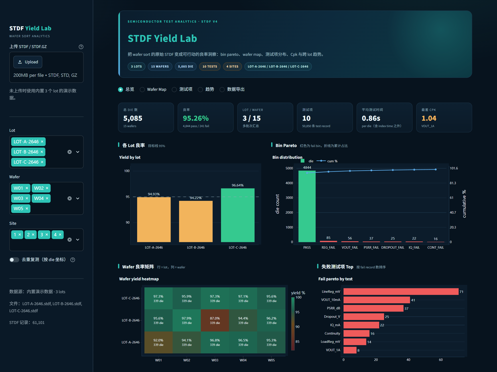
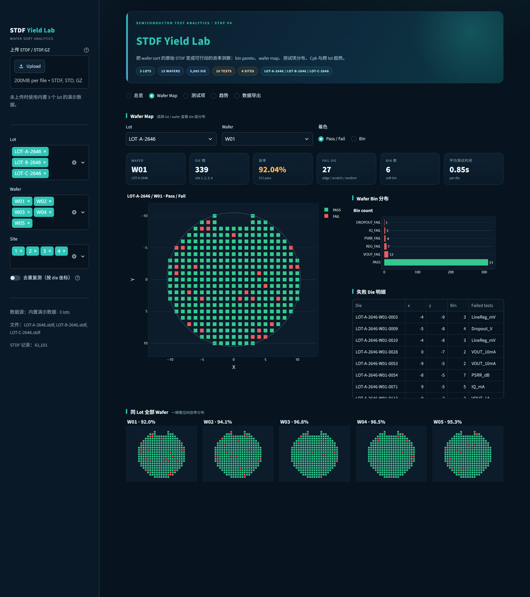
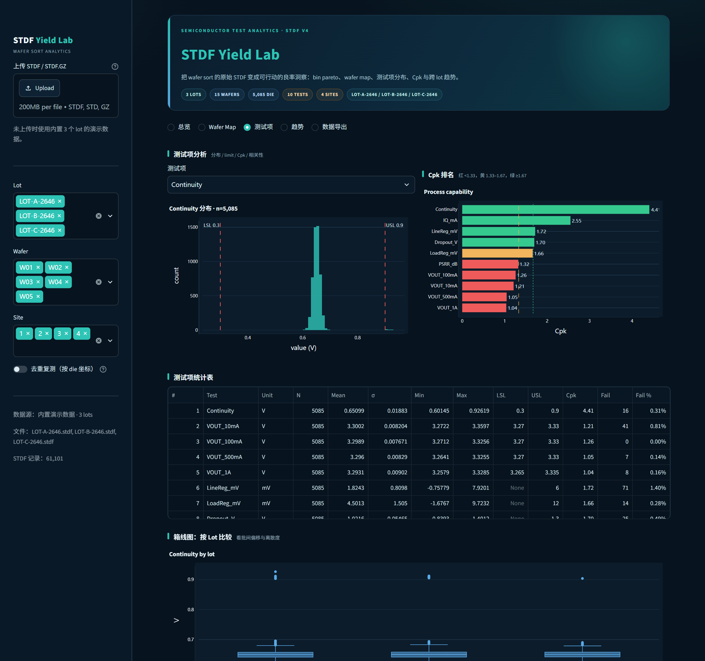
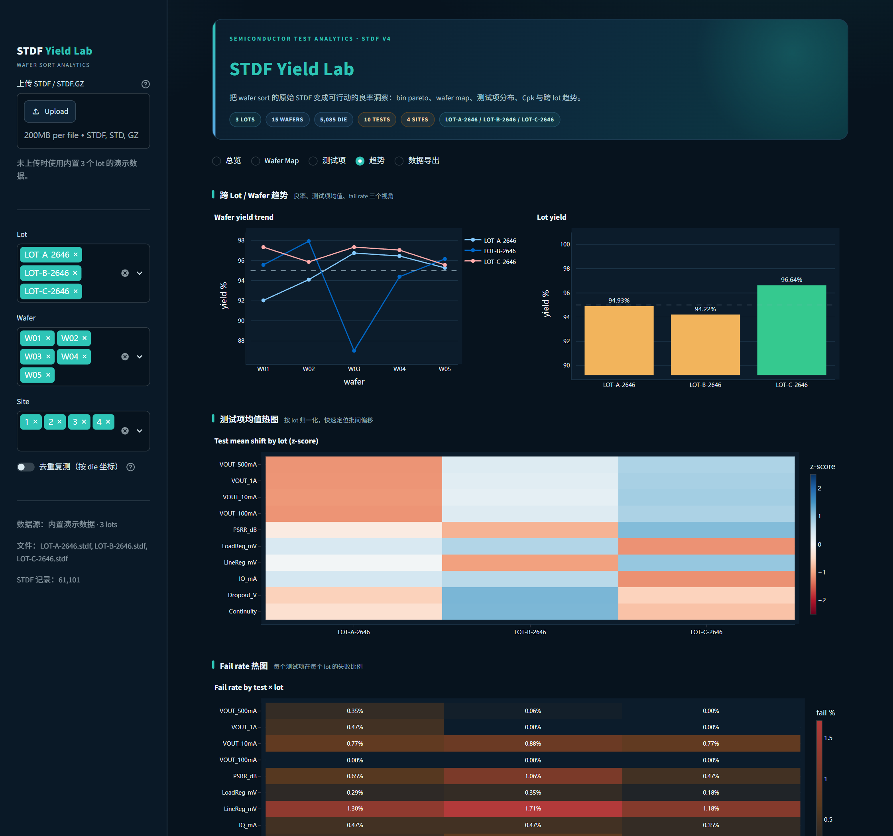

# STDF Yield Lab

> 把 wafer sort 的原始 STDF 变成可行动的良率洞察。纯 Python 解析 + Streamlit 全栈看板，支持上传真实 STDF、bin pareto、wafer map、Cpk、跨 lot 趋势与 CSV 导出。



## 界面

| 总览 | Wafer Map |
|---|---|
|  |  |

| 测试项 | 趋势 |
|---|---|
|  |  |

## 功能

| 模块 | 能力 |
|---|---|
| STDF 解析 | 自研 V4 parser，支持 FAR/MIR/WIR/WCR/PIR/PRR/PTR/HBR/PCR/WRR/MRR 等 18 类记录；`.stdf.gz` 自动解压 |
| 总览 | 良率、die 数、lot/wafer、平均测试时间、最差 Cpk、bin pareto、wafer 良率矩阵、失败项 Top |
| Wafer Map | die 级 pass/fail 或 bin 着色、wafer 轮廓、失败 die 明细、同 lot 全 wafer 小图 |
| 测试项 | 分布直方图 + limit 线、Cpk 排名、按 lot 箱线图、测试项相关性散点 |
| 趋势 | wafer/lot 良率趋势、测试项均值 z-score 热图、fail rate 热图 |
| 数据导出 | 筛选后 die 表 / test record 长表 CSV，UTF-8-SIG |
| 多文件 | 上传多个 lot，自动合并，part_uid 重编号；支持复测去重 |

## 快速开始

```bash
cd 02_STDF_Dashboard
python -m venv .venv
# Windows
.venv\Scripts\activate
pip install -r requirements.txt

streamlit run app.py
# 打开 http://localhost:8501
```

内置演示数据在 `data/LOT-*.stdf`（3 lots × 5 wafers × 339 die × 10 tests），可直接看效果，无需上传。

## 演示数据说明

`data/` 下的 STDF 由 `tools/generate_demo_stdf.py` 合成，用于展示解析与可视化能力：

- 3 个 lot（不同 baseline），每个 5 片 wafer
- 每片 339 die，4 个 site，10 个测试项
- 边缘 die 失败率更高；Lot B / W03 有一条人工"scratch"失效带，便于展示 wafer map
- 文件是合法 STDF V4，可直接用其他工具打开验证

重新生成：

```bash
python tools/generate_demo_stdf.py --out data --seed 20261118
```

## 部署到 Streamlit Community Cloud

1. **建 GitHub 仓库**（public 或 private 均可，Cloud 需要授权）：
   ```bash
   cd 02_STDF_Dashboard
   git init
   git add .
   git commit -m "STDF Yield Lab"
   git branch -M main
   git remote add origin https://github.com/<your-name>/stdf-yield-lab.git
   git push -u origin main
   ```
2. 打开 [share.streamlit.io](https://share.streamlit.io) → **New app**。
3. 选择仓库、branch `main`、main file path `app.py`（如果仓库根目录就是本目录）。
4. Deploy。首次构建约 2–4 分钟，之后每次 push 自动重新部署。
5. 在 App settings 里可绑定自定义域名、设置访问权限。

> 如果仓库根目录包含两个作品，请把 main file path 写成 `works/02_STDF_Dashboard/app.py`，并把 requirements 路径对应调整（Streamlit Cloud 默认读取仓库根目录的 requirements.txt）。最稳妥的做法是**把本目录单独作为一个仓库**。

## Docker

```bash
docker build -t stdf-yield-lab .
docker run -p 8501:8501 stdf-yield-lab
```

## 架构

```
app.py                  # Streamlit UI + Plotly 图表
stdf/parser.py          # STDF V4 记录解析（小端 + 大端回退）
stdf/analytics.py       # 良率/bin/Cpk/wafer map/趋势
tools/generate_demo_stdf.py
data/*.stdf             # 合成演示数据
tests/test_parser.py    # 解析/统计回归测试
```

解析流程：

```
STDF bytes → 记录头 (len, type, sub) → 按 SPECS 解字段 → PIR/PTR/PRR 关联
           → parts DataFrame + results 长表 → analytics → Plotly
```

## 支持的记录与限制

- STDF V4；自动检测大小端（以 FAR 记录长度 sanity check）。
- PTR 的 `RES_SCAL/LLM_SCAL/HLM_SCAL` 会换算；`TEST_FLG` bit7 判 fail，bit1/bit4 跳过无效/未执行。
- `LO_LIMIT=0` / `HI_LIMIT=0` 按"该侧无 limit"处理（STDF 常见约定）。
- MPR 多结果记录目前只读第一个结果；DTR 只保留原文。
- 复测去重按 `lot_id + wafer_id + x + y` 保留最后一次。
- 没有坐标的 final-test 数据仍可分析 bin/测试项/趋势，但 wafer map 会退化为单点。

## 为什么用自研 parser 而不是 pystdf

1. 不依赖老包（pystdf 对新 Python 支持不稳定），部署零额外依赖。
2. 只解析需要的字段，10 万级 PTR 也能在秒级完成。
3. 面试可以讲清楚 STDF 记录结构、PIR/PTR/PRR 关联和 limit 缩放——这是 ATE 数据岗位的高频问题。

## 测试

```bash
python -m unittest discover -s tests -v
```

## License

MIT（演示数据为合成数据，不含任何真实客户/晶圆厂信息）。
